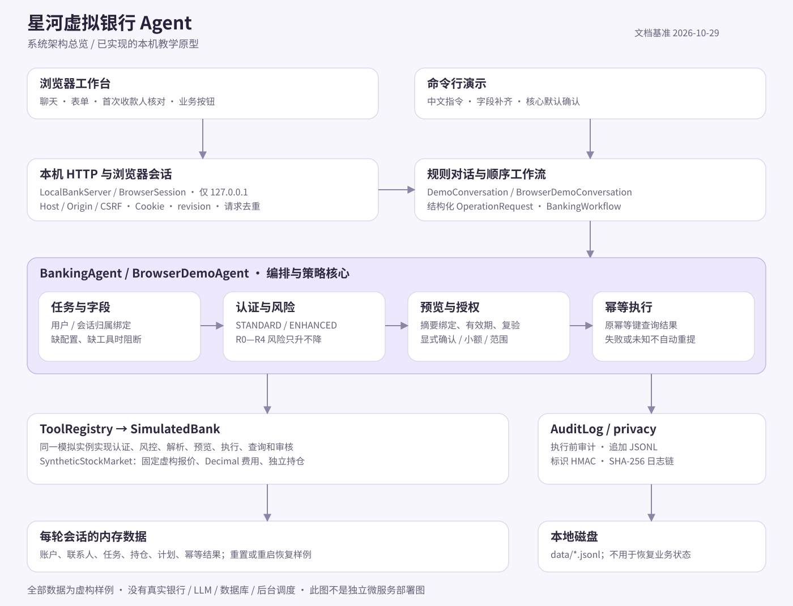

# 星河虚拟银行 Agent

本地银行业务教学原型：中文对话、交互式网页、首次收款人核对、模拟转账、虚构股票、账单分析与范围授权计划。代码基线 **2026-10-29**，**2026-11-01 完成安全加固**（详见 [加固说明](#2026-11-01-安全加固版)）。

## 评委快速导航

| 想做什么 | 从这里开始 |
| --- | --- |
| 3 分钟跑起来 | 双击 启动网页演示.cmd，输入「给张三转账2888元」 |
| 先看材料 | 提交材料/00-评委阅读指引.md（技术文档、安全自评报告、答辩 PPT 都在 提交材料/） |
| 验证结论 | python -X utf8 -m unittest discover -s tests -v（162 项应全部通过） |
| 看安全设计 | docs/安全设计.md、docs/权限分级实现.md、docs/已知风险清单.md |
| 部署与排错 | 部署说明.md、先看这里.txt |

在线仓库：<https://github.com/David1128666/xinghe-bank-agent>（仓库内容与本 GitHub 源码包一致，可浏览提交历史与 CI 结果；免安装运行时和完整提交材料以本压缩包为准）。

## 快速运行源码

需要 Python 3.11 或更新版本。在解压后的项目根目录运行，无需安装第三方运行依赖：

```powershell
python -X utf8 launch_demo.py --web
```

打开终端显示的 `http://127.0.0.1:端口`，保留启动窗口。输入 `给张三转账2888元`，核对虚构收款人后体验付款；全部测试使用 `python -X utf8 -m unittest discover -s tests -v`。GitHub 源码包不附带 Python 运行时；双击免安装版是另一种 Windows 分发形式。

## 技术材料导航

| 材料 | 内容 |
| --- | --- |
| [系统架构](docs/系统架构.md) | 组件架构、模块映射、请求时序和任务状态图 |
| [核心算法](docs/核心算法.md) | 解析、收款人核对、风险、确认、金额、股票、账单与工作流 |
| [安全设计](docs/安全设计.md) | 信任边界、会话、请求校验、幂等、审计和保护范围 |
| [权限分级实现](docs/权限分级实现.md) | 认证等级、风险等级、渠道和具体代码路径 |
| [已知风险清单](docs/已知风险清单.md) | 当前限制、触发条件、控制措施与改进方向 |
| [部署说明](部署说明.md) | 源码运行、Windows 分发、配置、验证和故障排查 |
| [测试用例](docs/测试用例.md) | 自动化用例矩阵、手工验收和测试边界 |
| [交付验收](docs/交付验收.md) | 本次实际验证结果与未执行范围 |



架构图另有 [PNG 图片](docs/架构图.png)，详细 Mermaid 图见架构文档。文档目录见 [docs/README.md](docs/README.md)。

这是按所附提示词实现的本地虚拟 Agent 原型。账户、交易、产品、商户、日历、认证、风控、审核、订单和审计密钥全部是合成样例；程序不连接真实银行、日历、商户或其他网络服务。命令行解析器是可读、确定性的中文规则解析器，不是通用大语言模型。

## 启动

**收到 ZIP 时先右键“全部解压缩”**，再进入解压后的文件夹，双击 **`启动网页演示.cmd`**。浏览器会自动打开带聊天、表单和交互按钮的星河银行页面。使用时保留启动窗口，结束时关闭窗口或按 Ctrl+C。不要在压缩包里直接启动；系统可能只把启动脚本解到临时目录，其他项目文件并不在它旁边。

Windows 10/11 x64 **免安装版**带有 `runtime/` 文件夹，自带 Python，不需要安装环境或联网。发送给同学时请发送整个新版压缩包。先关闭旧版黑色启动窗口，再从本版文件夹启动；页面底部会显示“API 智能版”字样。第一次可在网页输入 `给张三转账2888元`，核对弹窗中的虚构姓名与账户尾号后再付款。图形界面的详细操作见 `网页演示使用说明.txt`。

网页包含账户概览、账单图表、收款人选择、风险问卷、卡片开关、订阅管理、计划与提醒，以及确认/取消按钮。左侧保留 **一键买股票** 入口；生日采购计划已并入 **计划与提醒**，不再单独列出，可在“计划与提醒”中统一创建、查看和管理。原来的“转账 300 元”快捷项改为“转账”交互按钮。普通中文输入仍可使用原有命令；`启动演示.cmd` 保留命令行模式，输入 `退出` 结束。

**源码版**（没有 `runtime/`）需要 Python 3.11 或更新版本，不需要第三方运行依赖。启动脚本会依次检查内置运行时、Python Launcher 和 PATH 中的 Python；命令行也可在项目目录运行：

```powershell
python -X utf8 -m banking_agent --demo
```

源码版启动网页：`python -X utf8 launch_demo.py --web`。服务只绑定本机 `127.0.0.1`，默认选择空闲端口；如果浏览器未自动打开，使用启动窗口显示的地址。刷新网页保留当前浏览器会话，点击“新一轮演示”重置该会话；重启服务会恢复初始虚构业务数据。不同浏览器会话互相隔离，不应把本机地址当作可分享的线上网站。

出现启动错误时，窗口会保留具体原因；Python 已启动后的异常还会尝试写入 `data/startup-error.log`。可将完整窗口截图或该日志发给项目提供者。简明说明见 [先看这里.txt](先看这里.txt)，逐项功能对照见 [功能验收清单.md](功能验收清单.md)。

**网页转账新规则（2026-10-26）：**首次出现新的收款人时，先弹出“首次收款人身份核对”，可核对或修改虚构姓名和账户末四位。确认后将该联系人加入本轮收款人列表；金额小于 3000 元、信息完整且认证和风控检查通过的单次即时 CNY 转账随即执行。**恰好 3000 元及以上**在身份核对后继续展示转账摘要，仍须确认转账。取消首次核对不保存联系人，也不扣款；已核对收款人的普通小额即时转账不重复弹出身份核对。此核对只确认本地虚构样例，不查询或验证真实身份。

自然短句默认使用活期账户、立即执行、用途为日常转账；金额和收款人仍须提供。重名收款人先选择尾号，缺信息先补充；风险用途、累计限额或认证异常不会因小额规则被跳过。收款人列表只保存在本轮浏览器会话，刷新可保留；“新一轮演示”、重启服务或独立浏览器会话从初始样例开始。定时/周期转账和命令行原有转账确认流程保留。

虚拟股票目录明示样例价格、100 股金额、手续费和总扣款；点击“买入”按钮后先生成服务端预览，再点击“确认投资操作”才会按所示条件模拟成交，与转账、理财等资金类操作遵循同一确认规则（2026-11-01 加固版起不再提供免确认的一键成交）。跨渠道或认证不通过时会提示输入页面显示的演示安全码完成增强认证；单纯在聊天里说“切换到APP”不会提升认证等级。高风险操作进入“等待审核”，不会由演示程序自动批准。

## 已实现的场景

- **账户、账单与流水：**余额、交易查询；按月份、年份和自定义日期区间汇总；商户/分类/趋势统计；周期性支出识别；待核实异常特征；节省建议；分类纠正。分类会标为推测，异常不会直接判定为欺诈。
- **转账与 AA：**按姓名、演示手机号、历史备注解析收款人；网页新姓名先弹窗核对虚构身份，确认后保存到本轮收款人列表；重名时显式选择；即时、定时和周期转账；周期结束条件与取消；付款请求列表、发送 AA 请求和支付请求。定时任务只登记，不会立即扣款或在后台运行；“模拟运行计划”会走新一轮预览和确认。发送 AA 请求不扣取对方资金。
- **理财：**虚构产品目录、筛选与对比；包含地区、目标、期限、流动性、风险承受、经验、金额和适当性限制的问卷；风险适配结果；模拟申购、赎回、持仓和订单进度。资料不完整时只展示目录，不给个性化匹配。
- **一键买股票：**XH001、XH002、XH003 为完全虚构的教学股票，使用固定样例价，不读取真实行情。页面展示每手 100 股的本金、手续费与总扣款；点击买入后先生成服务端预览，再点击“确认投资操作”才会按所示条件模拟成交，活期余额与股数同步变化；股票持仓可查看含费平均成本、累计成本、样例市值和样例浮动盈亏。它与原有理财产品的申购/手动结算流程分别展示。
- **卡片：**卡片列表、申请与进度、额度请求、境内外/线上线下/无卡交易开关、临时锁定、解锁、挂失和补卡。挂失预览说明自动扣款影响、费用和预计时间；额度请求不会保证获批。
- **订阅与代扣：**订阅列表和费用汇总、周期扣款识别、续费提醒、价格变化提示；分别取消商户合同、银行代扣或银行卡周期付款；独立提交退款申请。停止代扣不会被描述为商户合同已取消或已退款。
- **跨场景计划：**读取虚构日历前需要明确授权；事件不会自动映射到亲属身份，生日日期由用户确认。可建立带预算预留、商品/商户边界、有效期、次数上限、通知规则和撤销方式的计划。一次性授权每次采购确认；符合已确认范围的范围/持续授权可在虚拟模拟中按边界执行，超出边界会拒绝。
- **安全与审计：**会话认证、风险分级、诈骗/胁迫/异常收款人升级、确认摘要绑定、确认过期、审计失败时阻止资金操作、幂等编号和状态查询；跨渠道后旧确认失效。关键操作写入本地哈希链 JSONL。
- **组合计划与辅助操作：**按依赖串联上述不同业务，每一步分别认证并按当前业务规则处理预览和确认；失败后停止依赖步骤。支持预算标签、普通提醒、查看提醒、争议申请及进度、代扣创建/恢复和模拟审核拒绝。

每日转账累计按上海日期和账户记录，并汇总当前虚拟用户的全部账户；即时转账、AA 付款和实际模拟执行的定时转账共用累计限额。预算预留会从对应账户的可用余额中扣除。多商品订单分别记录与审计，失败步骤不自动重试；部分成功时可取消计划并释放未用预留。

## 交互示例

查询账单：

```text
看2026-10账单
看2026年账单
分析2026-01-01到2026-03-31账单
把SIM-TX-105分类改为交通
```

即时转账与定时转账：

网页首次新收款人：输入 `给张三转账2888元`，弹出身份核对窗口；核对虚构姓名、账户尾号和本次金额，点击“确认身份并付款”。成功后活期余额由 50000.00 变为 47112.00，张三加入“收款人列表”。再输入 `给张三转账25元`，检查通过后直接付款，不再重复核对身份。取消首次核对则不保存、不扣款。

已有收款人示例：`给小明转账300元` 直接办理；`给小明转账3000元` 先显示摘要，再点击“确认转账”。新收款人首次转账 3000 元及以上时，身份核对窗口显示“确认身份并继续”，之后仍须核对并确认转账摘要。也可点击“转账”打开表单，填好后点击“提交转账”，流程与中文输入相同。本文固定余额示例从“新一轮演示”后的初始状态开始。

```text
现在从活期尾号1234转账50元给张伟用途AA
定时转账2026-11-01从活期转账100元给小明用途房租
每月定时转账2026-11-01从活期转账100元给小明每月执行3次用途房租
查看定时转账
取消定时任务SIM-SCH-0001
模拟运行计划SIM-SCH-0001
```

投资示例：

```text
风险测评 地区：虚构区，目标：稳健长期配置，期限：3年，流动性：中，R2，经验：新手，金额：5000元，适当性限制：无
比较产品 P-BOND-SIM 和 P-EQUITY-SIM
申购P-BOND-SIM 100元
模拟结算投资SIM-INV-0001
投资持仓
赎回P-BOND-SIM 50元
模拟结算投资SIM-INV-0002
```

申购/赎回提交后显示“处理中”，不会直接宣称已确认或已到账。上述手动结算也需要按摘要确认：申购结算后增加可用持仓，赎回结算后才增加余额。

虚拟股票示例：

```text
查看股票行情
买入 XH001 100股
确认投资操作
股票持仓
```

也可直接点左侧“买股票”，阅读目录中当前显示的样例价格与费用，依次点击“买入 XH001 · 100 股（需确认）”和“确认投资操作”。不要把样例价格、持仓或盈亏当作真实市场信息。

生日采购计划示例：

```text
授权读取模拟日历
查看模拟日历
创建生日计划2026-11-10活期预留1000元鲜花350元蛋糕200元范围授权最大金额600元虚拟花店虚拟蛋糕店鲜花蛋糕虚拟配送点A
模拟到期执行计划SIM-PLAN-0001商户虚拟花店商品鲜花和蛋糕总价500元
```

计划可补充 `预留开始2026-11-01`；未来开始的计划先不冻结余额，使用 `模拟预留计划SIM-PLAN-0001` 预览并确认激活。持续授权可指定 `最多执行2次` 和 `有效至2026-11-10`；每次检查累计商品预算、剩余预留、商户、有效期和次数。范围之外的订单会被阻止，需要重新建立并确认合适的授权。

组合与辅助操作示例：

```text
组合计划：查余额；现在从活期转账25元给小明用途午餐；临时锁卡尾号9012
继续组合计划
组合计划状态
取消组合计划
设置预算标签交通1000元
创建提醒2026-11-01内容核对月度账单
查看提醒
提交争议SIM-TX-105原因不认识这笔交易
查询争议进度
恢复代扣月光音乐
模拟审核拒绝
```

组合计划中的各步沿用当前渠道的业务规则：命令行中的资金和卡片变更仍须逐项确认；网页小额即时转账按上述新规则处理，其他待确认步骤仍需确认。某一步处于等待认证、等待确认、等待审核、已计划、处理中或未知状态时，依赖它的步骤会等待；失败时停止后续步骤。取消组合计划停止尚未开始的步骤，已受理、已创建的定时任务和已完成交易需要按其各自流程处理。

卡片和订阅示例：`申请卡`、`关闭线上交易尾号9012`、`临时锁卡尾号9012`、`调整尾号9012额度到5000元`、`查看订阅列表`、`停止代扣月光音乐`、`开启月光音乐价格变化提醒`。

## 文件与验证

- `banking_agent/agent.py`：任务状态机、认证、风险评估、确认、幂等执行、状态刷新和审计。
- `banking_agent/demo.py`：虚构银行数据、工具适配器与中文交互解析器。
- `banking_agent/stocks.py`：虚构股票目录、固定报价、费用计算、成交与独立持仓。
- `banking_agent/workflow.py`：按依赖串联多个操作，不绕过单项权限和确认。
- `banking_agent/web_app.py`：本机网页服务，沿用同一套 Agent；会话隔离、同源校验、预览版本绑定与重复请求保护。
- `banking_agent/web/`：无需第三方依赖的 HTML/CSS/JavaScript 前端，页面按钮调用本地 Agent。
- `banking_agent/tools.py`：适配器协议；没有真实服务实现。
- `AI_Banking_Agent_System_Prompt.md`：原提示词整理成的行为规范。
- `banking_agent_config.template.json`：独立部署模板，不参与虚拟演示。

演示任务和银行状态仅保存在内存中；默认审计文件写在本地 `data/demo-audit.jsonl`。演示密钥不适用于生产。运行测试：

```powershell
python -m unittest discover -s tests -v
```

验证内容包括原有业务与分发检查、网页接口、虚拟股票，以及首次收款人核对的专项回归。重点检查首次核对前不扣款、确认后保存联系人与付款、取消不保存、再次向已核对联系人付款、3000 元边界、姓名解析、重复请求保护、会话隔离、认证与风险检查，以及股票费用/持仓/余额一致性。维护者应在重新分发前运行完整测试和免安装包验收；实际结果记录在 [交付验收](docs/交付验收.md)。

演示仅支持 CNY 与给定虚构目录，APP/IM 是模拟渠道；定时执行、未来预算激活和原理财投资结算均由显式模拟按钮或命令触发，提醒只在本地列表显示。哈希链可检测日志改动，演示不提供生产级不可变存储或后台服务。网页审计分别保存在 `data/web-*.jsonl`，不会混用浏览器会话。

## Windows 免安装版

本包已包含 `runtime/`，解压后双击 `启动网页演示.cmd` 即可运行，不需要另行构建或安装 Python。源码版仍可使用 `python -X utf8 launch_demo.py --web` 启动。

## 2026-11-01 安全加固版

本版针对安全自评报告中的发现做了一轮加固，业务规则与演示脚本保持兼容：

- **认证不再可自证**：渠道由服务端会话状态决定；从 IM 升级到 APP 安全界面必须输入页面显示的一次性 6 位演示安全码（`认证 123456` 或页面按钮），聊天里说“切换到APP”不会提权，安全码用后即失效。
- **股票买入需要确认**：`INVESTMENT/buy_stock` 不再走范围授权直通路径，改为预览 + “确认投资操作”。
- **金额统一量化**：所有金额字段在入口按分为单位量化并回写，确认金额与实扣金额一致；科学计数法、千分位、全角数字、三位以上小数直接拒绝。
- **确认凭据改为一次性 nonce**：服务端随机生成、单次消费、与任务绑定，不再由 `csrf + 摘要` 推导。
- **限额跨会话共享**：新增进程级 `TransferLedger`，多开标签页或新会话无法重置当日累计额度。
- **会话与线程受控**：会话上限 30 改为 LRU 淘汰 + 30 分钟空闲回收，Cookie 增加 `Max-Age`；连接读超时 10 秒、并发处理上限 24，超限直接 503，不再无限建线程。
- **状态无界增长**：聊天窗口保留最近 60 条、请求去重表保留最近 2 000 条。
- **审计事件签名**：每条事件新增 `event_mac`（HMAC-SHA-256），无密钥无法重算整链。
- **脱敏补强**：验证码/密码/口令等关键词后的 4—8 位数字统一遮罩。
- **模型出网收口**：拒绝内网、保留地址与 `.local/.internal/.lan` 等主机名，仅允许公网 HTTPS（本机回环可用 HTTP）。
- **版本指纹**：不再回显 Python 版本，补齐 `Permissions-Policy`，非支持方法统一 405 JSON。
- **演示日期固定**：业务日期固定为 2026-10-29（`DEMO_TODAY`），样例与测试不再随真实日期到期。

测试规模从 148 项增加到 **162 项**（新增 `tests/test_hardening.py` 覆盖上述控制），全部通过。
