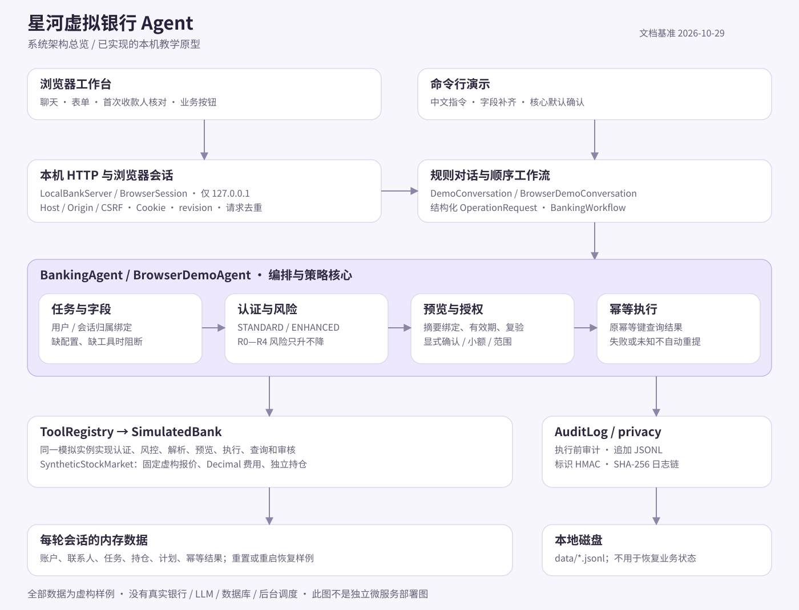

# 项目技术文档

基准：2026-10-29。描述的是当前可运行代码，不把目标架构或未来计划写成已经实现的功能。

| 阅读顺序 | 文档 | 适合回答的问题 |
| --- | --- | --- |
| 1 | [系统架构](系统架构.md) | 页面、对话、核心、工具和数据如何协作？ |
| 2 | [核心算法](核心算法.md) | 一句话如何变成可执行任务？金额、风险和股票怎样计算？ |
| 3 | [安全设计](安全设计.md) | 哪些请求会被阻断？确认、幂等和审计怎样工作？ |
| 4 | [权限分级实现](权限分级实现.md) | 认证等级、风险等级和模拟渠道有什么区别？ |
| 5 | [已知风险清单](已知风险清单.md) | 哪些能力尚未实现、不能作出哪些保证？ |
| 6 | [测试用例](测试用例.md) | 如何复现业务、边界和失败保护？ |
| 7 | [交付验收](交付验收.md) | 本次实际检查了什么，哪些验证尚未执行？ |

可下载的静态图：[SVG](架构图.svg)、[PNG](架构图.png)。细化的组件、时序、状态图采用 Mermaid，GitHub 可直接渲染。

部署与运行见根目录的 [部署说明](../部署说明.md)。自动测试结果仅代表已执行的测试范围；安全限制以风险清单为准。
