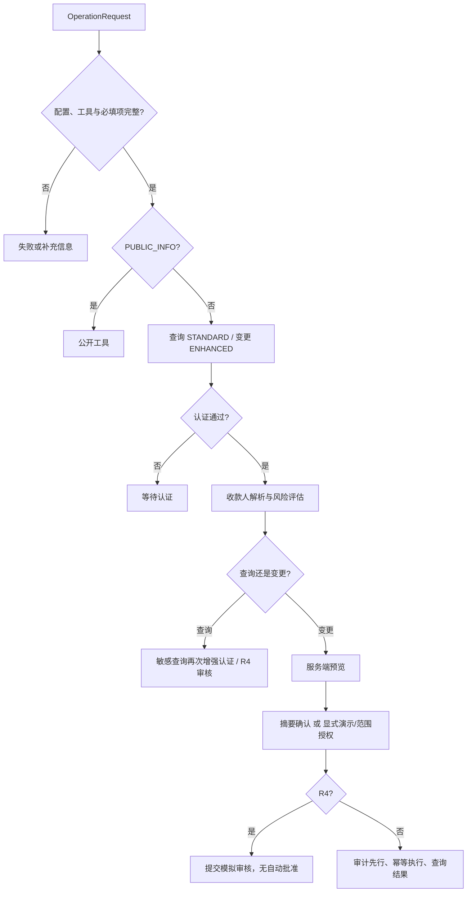

# 权限分级实现说明

核验基准：2026-10-29。当前项目实现的是**认证强度、操作风险、用户确认/范围授权、任务所有权**的组合控制，没有管理员/普通用户/审核员的真实角色系统，也没有真实账户登录。

相关文档：[安全设计](安全设计.md) · [已知风险清单](已知风险清单.md)

## 1. 四个概念需要分别理解

| 概念 | 代码表示 | 判断的问题 |
| --- | --- | --- |
| 认证强度 | `AuthLevel`、`AuthResult` | 当前渠道是否达到这次操作要求的认证等级？ |
| 操作风险 | `RiskLevel`、`RiskAssessment` | 这项操作需要何种流程，是否必须暂停并审核？ |
| 用户授权 | 确认短语、摘要、Web token、计划范围 | 用户是否授权了当前内容，或是否适用已明确设置的演示规则？ |
| 数据/任务所有权 | user_id、session_id、task_id；Web Cookie | 此请求是否属于当前用户与会话中的任务？ |

认证通过不表示每项业务已获授权；点击确认不表示风险已经消失；身份核对也不提升登录认证等级。

## 2. 认证等级与真实实现

定义见 [models.py](../banking_agent/models.py)；演示实现见 [demo.py](../banking_agent/demo.py) 的 `SimulatedBank.authenticate()`。

| 等级 | 数值 | 演示含义 | 当前是否存在实际认证手段 |
| --- | --- | --- | --- |
| `NONE` | 0 | 无账户操作认证；公共信息可不认证 | 没有登录要求的公开信息工具 |
| `STANDARD` | 1 | 普通账户查询的最低等级 | 固定虚构用户/会话在 `im` 渠道映射为本级 |
| `ENHANCED` | 2 | 所有变更、敏感查询要求的最低等级 | 固定虚构用户/会话在 `app` 渠道映射为本级 |
| `MANUAL` | 3 | 为扩展保留的枚举值 | 当前适配器不返回本级，核心未把它当成真实审核员角色，也没有要求此等级的已接入审批流程 |

演示认证公式：

```text
身份匹配 = (user_id, session_id) == 适配器绑定的会话身份（网页为 demo-user + web-<随机>）
渠道等级 = app → ENHANCED；im → STANDARD；other/未知 → NONE
渠道来源 = 服务端会话状态（不是请求参数、不是聊天文本）
authenticated = 身份匹配 且 渠道等级 >= 本次 required_level
```

网页会话使用固定演示用户 `demo-user`，但每个会话拥有独立的 `web-<随机>` 会话标识，适配器只接受绑定到自己的这一组身份。

渠道升级（IM → APP）必须通过 `AuthChallenge`：服务端在页面显示一次性 6 位演示安全码（5 分钟有效、用后轮换），用户输入正确后才把服务端渠道置为 `app`。聊天中的“切换到APP”不会改变认证等级；降级到 IM 不需要凭据，但会使待确认摘要失效。演示安全码模拟的是“验证器”，不是真实短信验证码、硬件密钥或可信设备证明。

## 3. 风险等级与操作下限

定义见 [policy.py](../banking_agent/policy.py) 的 `minimum_risk()` 和 `effective_risk()`。

| 风险 | 操作下限/典型场景 | 核心处理 |
| --- | --- | --- |
| R0 | 公共信息 | 使用公开信息工具，无账户查询权限 |
| R1 | 普通余额、流水、账单、卡片/订阅/持仓等查询 | 至少 STANDARD，风险评估后查询 |
| R2 | 分类纠正、预算标签、提醒、临时锁卡、建立跨场景计划 | 仍属于变更，至少 ENHANCED；默认摘要确认 |
| R3 | 转账、AA、投资、其他卡片操作、订阅操作、计划执行等；敏感查询可升级为 R3 | 变更至少 ENHANCED；普通路径先确认。查询须增强认证 |
| R4 | 诈骗/胁迫等信号、限额触发、未核对异常收款人、适当性未通过、工具要求人工审核 | 暂停自动执行；变更确认后提交审核；查询直接升级审核 |

有效风险取 `max(操作下限, 工具评估等级)`；`manual_review_required=True` 强制 R4。小额转账的风险下限仍为 R3，网页可以直接办理是**授权规则例外**，不是把风险降为 R1。

当前虚构参数如下，均为教学常量：

| 参数 | 值 | 用途 |
| --- | --- | --- |
| `low_risk_limit` | 1000 CNY | 金额风险参数；转账本身的下限已经是 R3 |
| `high_risk_limit` | 10000 CNY | 单笔达到此数额触发 R4 |
| `daily_transfer_limit` | 20000 CNY | 全部付款账户当日已执行转账累计 + 当次金额达到或超过此值时升级 R4 |
| `investment_confirm_limit` | 5000 CNY | 投资金额风险参数，不代表低于此值就普遍免确认 |
| `confirmation_ttl` | 300 秒 | 标准预览确认的有效期 |
| 网页普通即时转账阈值 | 严格小于 3000 CNY | 独立于风险参数的网页授权例外；恰好 3000 不适用 |

每日累计按上海日期统计，涵盖即时转账、实际执行的定时转账与 AA 付款，跨账户合计。已登记但未执行的定时任务不会被当成已付款。

## 4. 操作 × 渠道权限矩阵

下表均假定固定演示身份匹配，且配置、工具与输入完整。`允许`只代表可进入相应流程；资金与状态变更仍受余额、风险、授权和执行校验约束。

| 操作 | `other` / NONE | `im` / STANDARD | `app` / ENHANCED |
| --- | --- | --- | --- |
| 公共网点/产品规则等公开说明 | 允许公开工具 | 允许公开工具 | 允许公开工具 |
| 普通账户查询，风险 R1/R2 | 等待认证 | 允许查询 | 允许查询 |
| 敏感账户查询，风险 R3 | 等待认证 | 等待增强认证 | 允许查询 |
| 风险 R4 查询 | 不返回账户数据 | 须先增强认证 | 提交审核，不自动返回结果 |
| 任意变更，包括临时锁卡、预算、提醒 | 等待增强认证 | 等待增强认证 | 进入风险、预览及授权流程 |
| 新收款人首次转账 | 等待增强认证 | 等待增强认证 | 网页先核对虚构收款人，再按金额/风险继续 |
| 网页普通即时小额转账 | 不执行 | 不执行 | 满足全部小额例外条件可执行 |
| 股票买入（虚构） | 不执行 | 不执行 | 预览 + 用户确认后模拟成交 |
| R4 变更 | 不执行 | 不执行 | 确认后进入审核，仍不执行 |

标准 `BankingAgent` 和 CLI 的普通转账仍须确认；网页入口用 `BrowserDemoAgent` 子类显式启用小额规则，没有全局删除核心确认逻辑。

## 5. 主要调用链与约束位置



| 实现点 | 具体约束 |
| --- | --- |
| `BankingAgent.submit()` | 检查配置、工具、敏感字段并建立受控任务 |
| `_prepare_account_operation()` | 缺字段先暂停，查询至少 STANDARD、变更至少 ENHANCED |
| `_assess_and_continue()` | 合并风险下限；敏感查询提升认证，R4 查询升级审核 |
| `provide_information()` / `choose_recipient()` | 校验任务归属；补充后重新验证，重名选择不绕过认证 |
| `confirm()` | 归属、当前状态、渠道、有效期、短语、增强认证、最新风险/报价摘要 |
| `switch_channel()` / `resume_authentication()` | 跨渠道失效旧摘要；重新认证后重发确认 |
| `_owned_task()` | task_id 对应的 user_id 与 session_id 必须同时匹配 |
| `BrowserSession.send()` | Web revision、request_id、确认 token、首次身份待处理互斥 |
| `BankingWorkflow.advance()` | 仅依赖成功的步骤继续；所有步骤仍调用 Agent |

### 三种授权例外

1. 网页 `0 < amount < 3000` 的 CNY 单次即时转账，需零费用、解析完成、非 R4、增强认证及两次预览/风险一致。请求只按配置直接授权，审计不伪称用户点击过二次确认。
2. 虚构股票按明确指令、内置固定报价与费用生成预览，用户点击“确认投资操作”后模拟成交；没有接入真实证券账户，也不存在免确认的一键成交路径。
3. 生日计划范围/持续授权在已确认的商户、商品、预算、次数、有效期等范围内执行；任何新风险或越界仍暂停/拒绝。

## 6. 首次收款人身份核对的权限含义

`BrowserDemoAgent._resolve_and_assess()` 会把明确的新姓名暂停为 `AWAITING_INFORMATION`，附 `recipient_identity_required`，网页创建待核对 token。确认时只接受 2 至 16 位中文/间隔点姓名和 4 位演示数字；明确的连接词、代词等会被拒绝。可修改姓名；如果修改成已有收款人，尾号必须与其样例账户相符。

确认审计成功后将联系人置为 `known=True` 并保存本轮列表，再调用 `provide_information()` 恢复原任务。该变化会使“首次联系收款人”这一模拟风险条件解除，但诈骗信号、累计限额、认证、预览和实际执行仍照常检查。

核对通过没有授予访问其他会话、管理系统、提高转账限额或调用任意工具的权限；它也不能证明操作者知道真实银行账号、账户归属或真实姓名。

## 7. 人工审核与管理员能力的现状

`ManualReviewTool.submit()` 的 `accepted=True` 表示**队列受理**，不是审核通过。`SimulatedBank` 只记录 `pending`、`cancelled`、`declined` 等模拟状态。`refresh_review()` 可识别拒绝并转为失败，没有批准后自动执行资金的分支。

当前没有管理员用户表、角色分配、审核员工作台、双人复核、授权管理界面或角色凭据。因此不能把 R4 称为“管理员权限”、把 `MANUAL` 称为“已实现的审核员登录”，也不能将“模拟审核拒绝”当成真正的审批系统。

## 8. 验收方法

运行 `python -X utf8 -m unittest discover -s tests -v`，重点检查：

| 场景 | 自动化证据 |
| --- | --- |
| 普通查询/敏感查询与渠道 | [test_demo.py](../tests/test_demo.py) 的 `test_sensitive_read_requires_app_auth_and_invalid_input_never_executes` |
| 换渠道后旧确认无效 | 同文件 `test_scope_overrun_is_never_executed_and_channel_switch_invalidates_confirmation` |
| 认证恢复须重新确认 | [test_agent.py](../tests/test_agent.py) 的 `test_authentication_resume_reissues_confirmation_after_fresh_preview` |
| 高风险不执行 | 同文件 `test_high_risk_requires_confirmation_then_review_and_never_executes` |
| 网页小额/3000 元边界/定时认证 | [test_web.py](../tests/test_web.py) 的边界、认证和计划用例 |
| 首次身份不能绕过风险或串会话 | [test_recipients.py](../tests/test_recipients.py) 的 `test_identity_confirmation_does_not_bypass_risk_or_leak_contacts_between_sessions` |
| 单击买入不能绕过认证 | [test_stocks.py](../tests/test_stocks.py) 的 `test_authentication_and_risk_review_cannot_be_skipped_by_one_click` |

当前基线为 162 项。不存在的登录、MFA、RBAC 或真实审核批准能力不能由这些测试证明；相应限制列于[已知风险清单](已知风险清单.md)。
