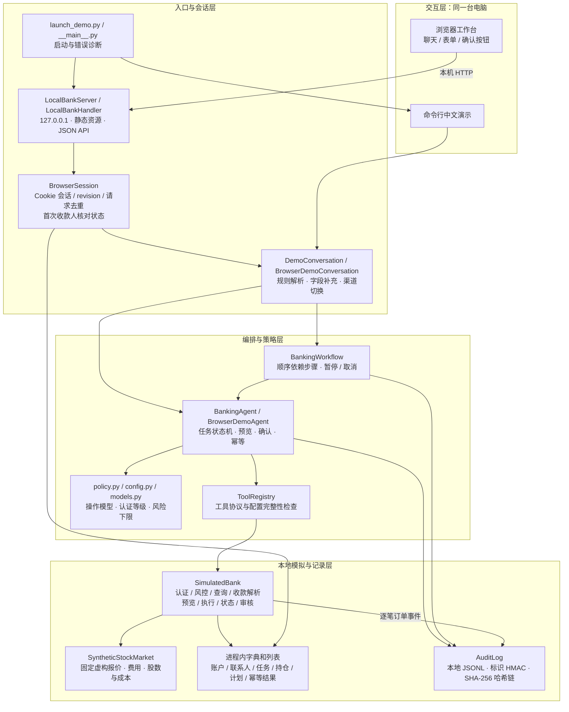
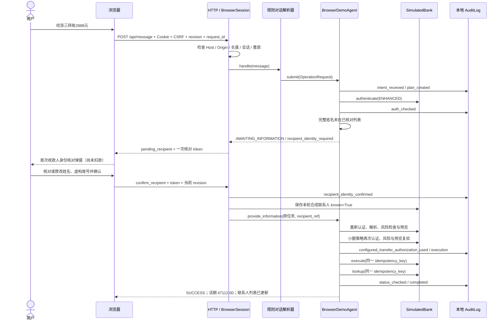
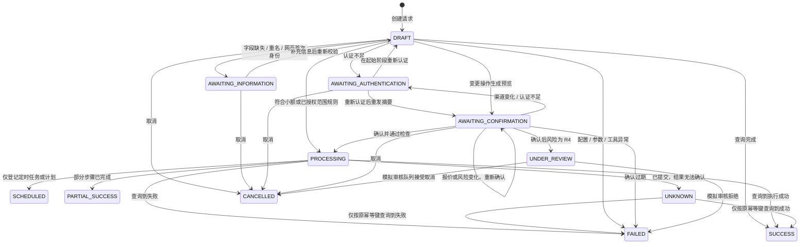

# 系统架构说明

文档基准：2026-10-29，2026-11-01 安全加固版补充。对象为本仓库当前的本地虚拟银行 Agent，包括网页、命令行与本地模拟工具。本文描述已经存在的代码；扩展建议不视为已实现功能。

## 1. 架构定位与边界

项目是一个**规则驱动、工具编排、带任务状态机的虚拟银行 Agent**。用户通过中文聊天或网页表单表达意图；系统将意图转换为 `OperationRequest`，经过字段、认证、风险与授权检查，再调用内存中的模拟工具。所有账户、股票、身份与业务结果均为合成样例。

运行时只依赖 Python 标准库，前端为原生 HTML/CSS/JavaScript。网页服务使用 `ThreadingHTTPServer`，仅监听 `127.0.0.1`；业务运行不调用外部网络 API。项目没有接入大语言模型推理、模型训练、向量检索、RAG、真实银行、真实身份系统、关系数据库、消息队列或后台任务调度器。`IntentParser` 只是可选协议定义，当前对话实际使用 `DemoConversation` 的规则解析。

## 2. 系统组件图

以下 Mermaid 图可直接在支持 Mermaid 的 GitHub Markdown 页面查看。

这是模块划分图，不代表独立部署的微服务。`SimulatedBank` 的同一个实例同时实现多个工具协议；每个浏览器会话创建独立的 Agent、模拟银行和审计文件。`BrowserDemoAgent` 继承核心 Agent，仅为网页增加首次收款人流程及小额即时转账策略。

## 3. 模块与职责

| 模块 | 已实现职责 | 关键入口 |
| --- | --- | --- |
| [launch_demo.py](../launch_demo.py) | 确定项目目录、检查 Python 版本、选择网页/命令行、尝试保存启动错误日志 | `main` |
| [web/index.html](../banking_agent/web/index.html)、[app.js](../banking_agent/web/app.js)、[app.css](../banking_agent/web/app.css) | 导航、聊天、表单、身份弹窗、收款人列表、图表和业务状态展示 | `send`、`render`、`syncRecipientDialog` |
| [web_app.py](../banking_agent/web_app.py) | 本机 HTTP、白名单静态路由、浏览器会话、请求校验、去重和网页策略 | `LocalBankServer`、`LocalBankHandler`、`BrowserSession` |
| [demo.py](../banking_agent/demo.py) 的对话部分 | 中文规则意图识别、字段提取、当前任务补充、渠道切换、结果格式化 | `DemoConversation.handle`、`_parse`、`_supplement` |
| [agent.py](../banking_agent/agent.py) | 配置/工具检查、任务归属、状态转换、认证、风险、预览、确认、执行与状态核验 | `BankingAgent.submit`、`confirm`、`_execute_once` |
| [models.py](../banking_agent/models.py)、[policy.py](../banking_agent/policy.py)、[config.py](../banking_agent/config.py) | 请求/结果/等级模型、操作风险下限、有效风险、所需工具与配置 | `OperationRequest`、`TaskState`、`effective_risk` |
| [tools.py](../banking_agent/tools.py) | 认证、风险、查询、解析、预览、执行、状态、审核的协议及注册表 | `ToolRegistry` |
| [demo.py](../banking_agent/demo.py) 的工具部分 | 全部合成业务数据与工具实现，含账单、转账、卡片、订阅、计划、理财和审核 | `SimulatedBank`、`build_demo_agent` |
| [stocks.py](../banking_agent/stocks.py) | 固定虚构股票目录、报价、费用、成交记录、独立持仓 | `SyntheticStockMarket` |
| [workflow.py](../banking_agent/workflow.py) | 将多个请求串成依赖链，复用单项 Agent 检查，失败时停止后续依赖 | `BankingWorkflow.advance` |
| [audit.py](../banking_agent/audit.py)、[privacy.py](../banking_agent/privacy.py) | 本地日志与哈希链、用户标识散列、敏感字段拒绝和输出脱敏 | `AuditLog`、`redact_tool_output` |
| [tests/](../tests/) | 核心、业务、网页、收款人、股票、启动的可执行回归测试 | `unittest` |

## 4. 首次收款人转账时序

以初始活期余额 50000 元、输入“给张三转账2888元”为例。以下为网页普通即时转账的成功路径；任何字段、认证、风险、余额或审计检查失败都可能中断流程。

姓名与四位尾号都是本地演示数据，弹窗不查询真实身份。身份确认会先保存联系人，再继续付款；如果随后认证、风险、余额或执行检查未通过，付款不会因此自动成功，已核对联系人也不保证回滚。金额恰好 3000 元或以上时，身份确认后还需核对并确认转账摘要。取消首次身份核对不保存联系人、不扣款。

## 5. 核心任务状态图

图中省略部分重复认证/异常分支，准确条件以 `agent.py` 为准。`PROCESSING` 也可能长期表示投资订单等已受理状态；`SCHEDULED` 不是已经扣款成功；`UNDER_REVIEW` 不会自动批准资金操作。`UNKNOWN` 只允许查询现有幂等键，不自动重新执行。

## 6. 接口与数据流

| 路由 | 作用 | 状态影响 |
| --- | --- | --- |
| `GET /`、`/app.js`、`/app.css`、`/favicon.svg` | 固定静态资源白名单 | 不直接办理业务 |
| `GET /api/state` | 建立/读取浏览器会话并返回当前概览、消息、任务、联系人 | 概览调用受认证/审计约束的余额查询；可能创建会话和查询任务 |
| `POST /api/message`，普通 `message` | 对话或表单生成的中文业务指令 | 进入规则解析和 Agent |
| 同一 POST，`confirm_recipient` / `cancel_recipient` | 核对或取消首次收款人 | 校验核对 token、当前 revision 和原任务 |
| 同一 POST，`reset` | 新一轮演示 | 重建该会话的 Agent/模拟数据；已有本地审计文件保留 |

HTTP 层对同一浏览器会话持有 `RLock`，让该会话请求顺序处理；服务器会话表和审计写入另有进程内锁。它们不是分布式锁，也不提供数据库事务。

`request_id` 用于网页请求内容去重，`revision` 阻止旧页面提交，`confirmation_token` 绑定当前预览，`recipient_token` 绑定当前身份核对。这些标识有不同用途；不能互相替代，也不能替代核心认证和风控。

## 7. 数据生命周期与部署视图

| 数据 | 存放位置 | 生命周期 |
| --- | --- | --- |
| 账户、联系人、交易、卡片、订阅、持仓、预算与计划 | 各会话 `SimulatedBank` 的字典/列表 | 刷新当前会话保留；重置或服务重启恢复样例 |
| 当前任务、请求指纹、执行幂等结果 | Agent / BrowserSession / 模拟银行内存 | 当前进程/会话；不跨进程共享，不在重启后恢复 |
| 浏览器消息与首次身份核对状态 | `BrowserSession` | 同一 Cookie 会话内；独立浏览器会话隔离 |
| 命令行演示审计 | 默认 `data/demo-audit.jsonl` | 文件保留，和内存业务状态不同 |
| 网页审计 | `data/web-<随机标识>.jsonl` | 每次新建模拟银行实例使用新的文件；重置不删除旧文件 |
| 启动异常诊断 | `data/startup-error.log` | 出错时尽量写入，可能含本机绝对路径 |

运行部署为“一台电脑、一个 Python 服务进程、一个或多个隔离的浏览器演示会话”。Windows 免安装包额外带经过校验的 CPython 运行时；GitHub 源码包运行需要本机 Python 3.11 或更新版本。构建时下载/校验运行时与离线业务运行是不同阶段。

跨会话隔离依赖服务器端的独立对象；并非真实多用户身份平台。同一浏览器配置文件共享相同服务 Cookie 的标签页会共享本轮数据。当前最多保留 30 个服务器会话，未实现空闲过期清理与资源配额。

后续阅读：[核心算法](核心算法.md)。安全与权限的实际保障和局限，见同目录安全、权限和风险文档。
